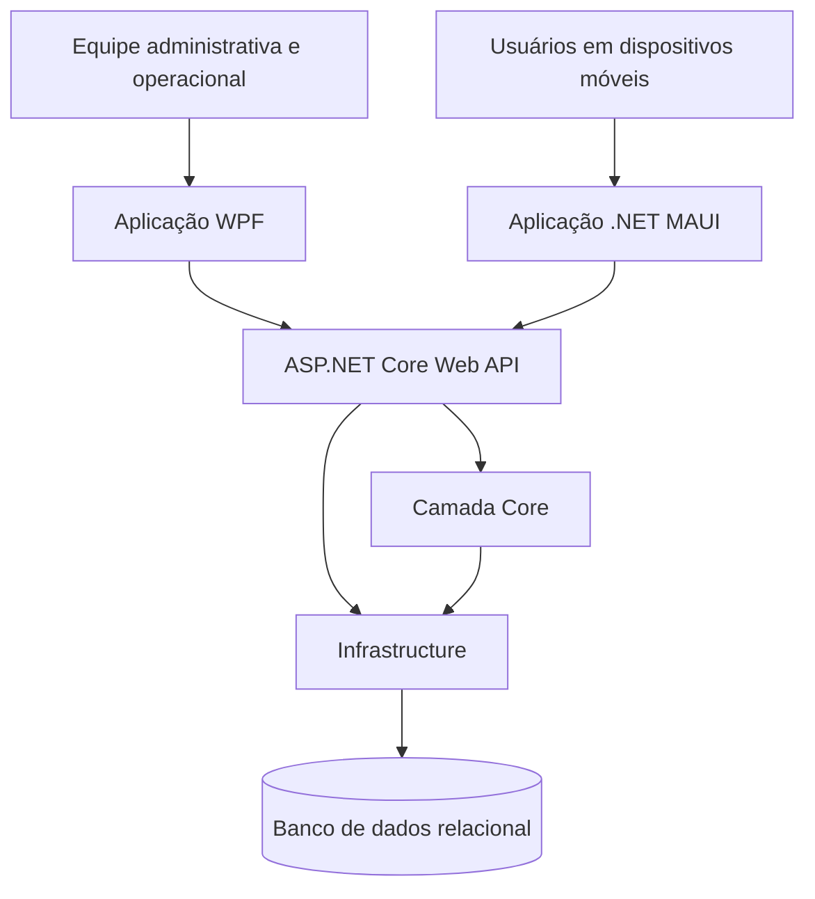

# 🐾 G.A.I.A.
<h3 align="center">Guardião Animal de Integração e Assistência</h3>

  <strong>Uma plataforma integrada para proteção, comunicação e gestão animal.</strong>

  
  &nbsp;&nbsp;
  

  
  
  
  
  

---

## 🐾 Sobre o projeto

O **G.A.I.A. (Guardião Animal de Integração e Assistência)** é um projeto individual de desenvolvimento de software, concebido em parceria institucional com o **Centro de Proteção Animal (CEAN)** de Cruzeiro – SP.

A proposta consiste em desenvolver uma plataforma integrada para auxiliar na comunicação com a população, no gerenciamento de ocorrências e no acompanhamento dos animais sob responsabilidade da instituição.

O sistema busca centralizar informações, organizar processos operacionais e facilitar o acesso ao histórico dos animais, contribuindo para uma gestão mais eficiente e para a proteção animal.

## 🎯 Objetivos

- Centralizar informações e registros relacionados aos animais.
- Facilitar o recebimento e a triagem de solicitações da população.
- Organizar o gerenciamento e o acompanhamento de ocorrências.
- Melhorar o controle de animais, baias e movimentações.
- Registrar históricos de atendimentos, saúde e comportamento.
- Auxiliar no acompanhamento de adoções e lares temporários.
- Disponibilizar consultas, relatórios e indicadores para apoiar decisões.

## 🧩 Módulos do sistema

A plataforma está organizada em dez módulos principais, que representam as áreas funcionais previstas para o desenvolvimento.

### 1. Dashboard e indicadores

Painel inicial para visualização de informações relevantes da instituição.

- Quantidade de animais cadastrados.
- Ocorrências abertas, em andamento e finalizadas.
- Ocupação e capacidade das baias.
- Indicadores de adoções e lares temporários.
- Resumo de atividades e movimentações.

### 2. Comunicação e triagem de solicitações

Área destinada ao recebimento e à organização das solicitações encaminhadas pela população.

- Registro de solicitações e identificação do solicitante.
- Classificação por categoria, como resgate, abandono, ferimento, adoção e castração.
- Inclusão de descrição, imagens e localização.
- Triagem e definição de prioridade.
- Conversão de solicitações em ocorrências.
- Possibilidade futura de integração com canais como WhatsApp e Instagram.

### 3. Gestão de ocorrências

Gerenciamento do ciclo de atendimento das ocorrências registradas.

- Identificação e categorização.
- Definição de prioridade e localização.
- Associação com animais e solicitantes.
- Atribuição de responsáveis.
- Controle de status e histórico de alterações.
- Registro de resultados e finalização do atendimento.

### 4. Cadastro e rastreamento de animais

Cadastro centralizado para identificação e acompanhamento dos animais.

- Identificação, espécie, sexo e idade.
- Características físicas e fotografias.
- Origem e situação atual.
- Localização e responsável.
- Histórico de ocorrências e atendimentos.
- Pesquisa e filtros para localização dos registros.

### 5. Gestão do canil

Controle da estrutura física e da ocupação dos espaços destinados aos animais.

- Cadastro e identificação de baias.
- Controle de capacidade e ocupação.
- Registro de alojamento dos animais.
- Identificação de espaços de isolamento.
- Histórico de movimentações.
- Acompanhamento da disponibilidade dos espaços.

### 6. Acompanhamento e histórico dos animais

Registro contínuo das informações relacionadas à permanência e aos cuidados dos animais.

- Histórico de saúde e atendimentos.
- Registros de alimentação e comportamento.
- Observações e acompanhamento.
- Histórico de ocorrências.
- Registro de localização e movimentações.
- Acompanhamento de animais em lares temporários.

### 7. Gestão de lares temporários

Organização dos acolhimentos temporários realizados por responsáveis externos.

- Cadastro de responsáveis.
- Associação entre responsável e animal.
- Registro de datas de entrada e saída.
- Acompanhamento do período de acolhimento.
- Registro de retornos e encaminhamentos.
- Histórico de lares temporários.

### 8. Adoção e destino do animal

Controle dos processos de adoção e dos encaminhamentos realizados pela instituição.

- Identificação dos animais disponíveis para adoção.
- Cadastro de interessados.
- Acompanhamento do processo de adoção.
- Registro de responsáveis e datas.
- Controle do destino do animal.
- Histórico de adoções e encaminhamentos.

### 9. Consultas, relatórios e estatísticas

Área destinada à análise das informações registradas na plataforma.

- Consultas por espécie e situação.
- Estatísticas por localização e período.
- Ocorrências por categoria e prioridade.
- Análise do tempo de atendimento.
- Indicadores de ocupação das baias.
- Dados de adoções e lares temporários.
- Possibilidade futura de exportação de relatórios.

### 10. Base de informações

Centralização de conteúdos informativos e orientações para a população.

- Perguntas frequentes (FAQ).
- Orientações sobre adoção e castração.
- Informações sobre campanhas e eventos.
- Divulgação de serviços e ações institucionais.
- Orientações sobre cuidados e proteção animal.
- Possibilidade futura de ações educativas e automatizadas.

## 🏗️ Arquitetura da solução

O G.A.I.A. está sendo planejado com uma arquitetura em camadas, utilizando uma API centralizada para comunicação entre as interfaces e a camada de dados.

A proposta contempla duas aplicações com finalidades diferentes, compartilhando regras de negócio e informações por meio de uma estrutura central.

### Visão geral

### Organização da solução

| Projeto | Responsabilidade |
|---|---|
| `CEAN.WPF` | Interface administrativa para desktop. |
| `CEAN.MAUI` | Interface multiplataforma para dispositivos móveis. |
| `CEAN.Core` | Entidades, DTOs, contratos, enums, validações e regras compartilhadas. |
| `CEAN.API` | Endpoints, autenticação e comunicação entre aplicações e serviços. |
| `CEAN.Infrastructure` | Persistência, Entity Framework Core e acesso ao banco de dados. |
| `CEAN.Tests` | Testes automatizados e validação das regras de negócio. |

### Fluxo de comunicação

1. O usuário interage com uma das aplicações.
2. A interface envia uma solicitação à API.
3. A API aplica as validações e regras de negócio necessárias.
4. A camada de infraestrutura realiza as operações de persistência.
5. A API retorna os dados para a interface solicitante.

## 💻 Tecnologias e ferramentas

As tecnologias abaixo compõem a stack prevista para a implementação do projeto.

### Linguagem e plataforma

- **C#** — linguagem principal.
- **.NET** — plataforma de desenvolvimento.
- **ASP.NET Core Web API** — construção da API central.

### Interfaces

- **WPF** — aplicação desktop com XAML e padrão MVVM.
- **.NET MAUI** — aplicação multiplataforma com interface adaptada a dispositivos móveis.

### Dados e persistência

- **Entity Framework Core** — mapeamento objeto-relacional e persistência.
- **SQL Server ou PostgreSQL** — banco de dados relacional, a definir conforme as necessidades técnicas.

### Qualidade e organização

- **Git e GitHub** — versionamento e organização do código.
- **Testes automatizados** — validação de regras e funcionalidades.
- **MVVM** — separação entre interface, apresentação e lógica de interação.

## 🎨 Identidade visual

A identidade visual do G.A.I.A. foi pensada para transmitir proteção, confiança, organização e tecnologia.

A marca utiliza duas patas como elementos simbólicos: uma laranja, representando o cão, e outra turquesa, representando o gato.

### Paleta de cores

| Cor | Código | Aplicação |
|---|---|---|
| Verde-petróleo | `#006B5B` | Cor institucional principal. |
| Turquesa | `#0B9E8A` | Elementos de destaque e representação felina. |
| Laranja | `#F39200` | Destaques e representação canina. |

A identidade visual deverá ser aplicada de maneira consistente nas interfaces, nos elementos gráficos e nos materiais de apresentação do projeto.

## 🔐 Segurança e confiabilidade

A arquitetura prevê mecanismos para proteger as informações e organizar o acesso às funcionalidades.

- Autenticação de usuários.
- Controle de acesso por perfis e permissões.
- Validação de dados.
- Registro de alterações e auditoria.
- Tratamento de erros e exceções.
- Proteção de dados pessoais.
- Comunicação centralizada por meio da API.

### Perfis de acesso previstos

- **Administrador:** gerenciamento geral do sistema e das permissões.
- **Equipe CEAN:** acesso às rotinas administrativas e operacionais.
- **Atendente:** recebimento e triagem de solicitações.
- **Responsável por animais:** acesso às informações e atividades relacionadas aos animais sob sua responsabilidade.

## 📈 Etapas de desenvolvimento

O projeto será desenvolvido de forma incremental, priorizando a estrutura técnica e as funcionalidades essenciais antes da ampliação dos módulos.

1. Análise de requisitos e definição dos fluxos.
2. Modelagem do domínio e estruturação do banco de dados.
3. Construção da API e das regras de negócio compartilhadas.
4. Desenvolvimento da interface administrativa WPF.
5. Desenvolvimento da interface multiplataforma MAUI.
6. Integração entre aplicações e serviços.
7. Implementação dos módulos e validação das funcionalidades.
8. Testes, ajustes e documentação.

## 📌 Status do projeto

O G.A.I.A. encontra-se em fase de planejamento e estruturação técnica. As funcionalidades descritas neste documento representam o escopo proposto e não devem ser interpretadas como funcionalidades já concluídas.

O andamento de cada módulo será atualizado conforme sua implementação e validação.

## 🤝 Parceria institucional

**Centro de Proteção Animal (CEAN) — Cruzeiro, SP**

O projeto busca desenvolver uma solução alinhada às necessidades reais da instituição, considerando seus processos de trabalho e os desafios envolvidos na proteção e no acompanhamento dos animais.

A parceria institucional é parte importante da compreensão dos requisitos e da validação das soluções propostas.

---

  
  <strong> G.A.I.A. — Tecnologia a serviço da proteção animal.</strong>
  

