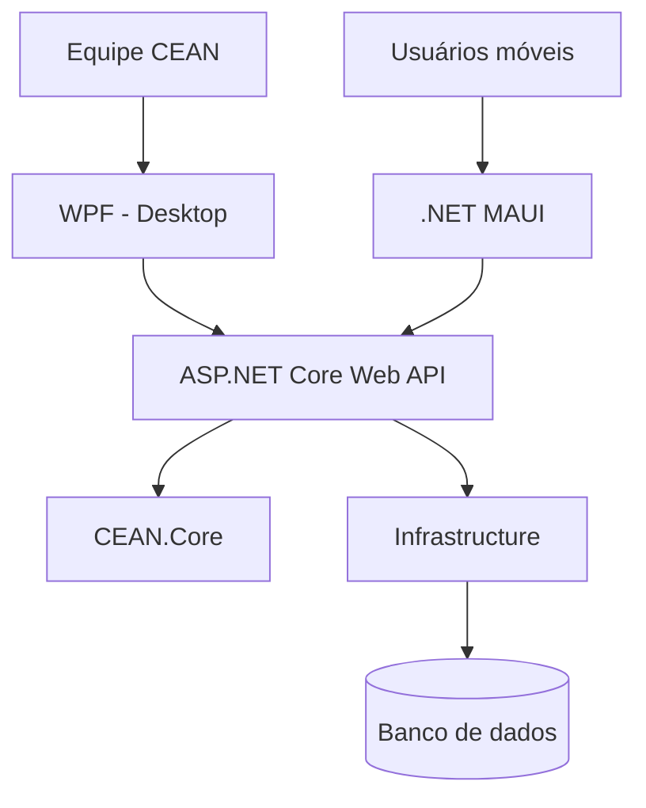

# 
 G.A.I.A. 

<h3 align="center">Guardião Animal de Integração e Assistência</h3>

  Plataforma integrada de proteção, comunicação e gestão animal.

  
  
  
  
  
  

---

<h2> Sobre o projeto</h2>

O **G.A.I.A. (Guardião Animal de Integração e Assistência)** é um projeto individual de desenvolvimento de software, concebido em parceria institucional com o **Centro de Proteção Animal (CEAN)** de Cruzeiro – SP.

A proposta é desenvolver uma plataforma integrada para centralizar informações, facilitar a comunicação com a população, organizar solicitações e ocorrências e acompanhar os animais sob responsabilidade da instituição.

O projeto busca utilizar a tecnologia para apoiar os processos administrativos e operacionais do CEAN, contribuindo para uma gestão mais organizada, eficiente e acessível.

<h2> Objetivos</h2>

<table>
  <tr>
    <td align="center" width="33%">
       
      <strong>Centralização</strong> 
      Unificar informações e históricos em uma plataforma.
    </td>
    <td align="center" width="33%">
       
      <strong>Organização</strong> 
      Melhorar a triagem e o gerenciamento de ocorrências.
    </td>
    <td align="center" width="33%">
       
      <strong>Acompanhamento</strong> 
      Facilitar o controle e o histórico dos animais.
    </td>
  </tr>
</table>

---

<h2> Parceria institucional</h2>

O projeto **G.A.I.A.** é desenvolvido em parceria com o **Centro de Apoio ao Animal (CEAN)**, instituição vinculada ao município de Cruzeiro/SP, que desempenha um papel importante na proteção, acolhimento e cuidado de animais em situação de vulnerabilidade.

O trabalho do CEAN envolve diferentes frentes de atuação, incluindo o acolhimento de animais resgatados, assistência veterinária, vacinação, castração, orientação à população sobre cuidados e prevenção de maus-tratos, além do incentivo à adoção responsável.

Mais do que oferecer assistência aos animais, o CEAN contribui diretamente para a saúde pública, o controle populacional de cães e gatos e a conscientização da comunidade sobre a responsabilidade e o respeito à vida animal.

### Nosso propósito

O G.A.I.A. nasce com o propósito de contribuir com esse trabalho, oferecendo ferramentas tecnológicas que possam facilitar a organização das atividades, centralizar informações, melhorar o acompanhamento dos animais e auxiliar na comunicação entre a instituição e a população.

**Acreditamos que a tecnologia pode ser uma importante aliada na proteção animal.**

> Proteger os animais também é cuidar da comunidade. Cada atendimento, acolhimento e adoção representa um passo em direção a uma realidade mais responsável e humanitária.

> Nosso objetivo é transformar informação em organização, e organização em melhores condições para o cuidado animal.

### Conheça e apoie o trabalho do CEAN

<h3 align="center">Acompanhe o CEAN</h3>

  
  
  

O trabalho de instituições como o CEAN merece reconhecimento, apoio e participação da comunidade. Acompanhe suas atividades, divulgue as iniciativas e contribua para fortalecer a causa animal.

---

<h2> Módulos do sistema</h2>

A plataforma está planejada em dez módulos integrados, compartilhando informações e regras de negócio.

<table>
  <tr>
    <td width="50%" valign="top">
      <h3> 01. Dashboard</h3>
      Painel de indicadores e visão geral da instituição.
      - Total de animais cadastrados.
      - Ocorrências por status.
      - Ocupação das baias.
      - Adoções e lares temporários.
      - Indicadores e gráficos.
    </td>
    <td width="50%" valign="top">
      <h3> 02. Comunicação e triagem</h3>
      Recebimento e organização das solicitações.
      - Cadastro de solicitações.
      - Categorias e prioridades.
      - Imagens e localização.
      - Triagem e encaminhamento.
      - Futura integração com canais digitais.
    </td>
  </tr>
  <tr>
    <td width="50%" valign="top">
      <h3> 03. Gestão de ocorrências</h3>
      Controle do atendimento e dos encaminhamentos.
      - Identificação e categorização.
      - Definição de prioridade.
      - Associação com animais e solicitantes.
      - Responsáveis e status.
      - Histórico e finalização.
    </td>
    <td width="50%" valign="top">
      <h3> 04. Cadastro de animais</h3>
      Identificação e rastreamento dos animais.
      - Espécie, sexo e idade.
      - Características e fotografias.
      - Origem e situação.
      - Localização e responsável.
      - Histórico e filtros.
    </td>
  </tr>
  <tr>
    <td width="50%" valign="top">
      <h3> 05. Gestão do canil</h3>
      Organização dos espaços e alojamentos.
      - Cadastro de baias.
      - Capacidade e ocupação.
      - Alojamento dos animais.
      - Espaços de isolamento.
      - Histórico de movimentações.
    </td>
    <td width="50%" valign="top">
      <h3> 06. Histórico dos animais</h3>
      Acompanhamento contínuo dos cuidados.
      - Saúde e atendimentos.
      - Alimentação e comportamento.
      - Observações.
      - Ocorrências anteriores.
      - Localização e movimentações.
    </td>
  </tr>
  <tr>
    <td width="50%" valign="top">
      <h3> 07. Lares temporários</h3>
      Controle dos acolhimentos temporários.
      - Cadastro de responsáveis.
      - Associação com animais.
      - Datas de entrada e saída.
      - Acompanhamento.
      - Retornos e encaminhamentos.
    </td>
    <td width="50%" valign="top">
      <h3> 08. Adoção e destino</h3>
      Organização dos processos de adoção.
      - Animais disponíveis.
      - Cadastro de interessados.
      - Acompanhamento do processo.
      - Registro de responsáveis.
      - Histórico de destinos.
    </td>
  </tr>
  <tr>
    <td width="50%" valign="top">
      <h3> 09. Relatórios e estatísticas</h3>
      Análise dos dados da instituição.
      - Consultas por espécie e situação.
      - Ocorrências por categoria.
      - Análise por localização e período.
      - Tempo de atendimento.
      - Indicadores e exportações futuras.
    </td>
    <td width="50%" valign="top">
      <h3> 10. Base de informações</h3>
      Conteúdos e orientações à população.
      - Perguntas frequentes.
      - Orientações sobre adoção.
      - Informações sobre castração.
      - Campanhas e eventos.
      - Conteúdos educativos.
    </td>
  </tr>
</table>

---

<h2> Arquitetura da solução</h2>

A solução está sendo planejada com uma arquitetura em camadas, utilizando uma API centralizada para compartilhar dados e regras de negócio entre as aplicações.

### Visão geral

### Estrutura da solução

| Projeto | Responsabilidade |
|---|---|
| `CEAN.WPF` | Interface administrativa desktop. |
| `CEAN.MAUI` | Aplicação multiplataforma. |
| `CEAN.Core` | Domínio, DTOs, contratos e regras compartilhadas. |
| `CEAN.API` | Endpoints e comunicação centralizada. |
| `CEAN.Infrastructure` | Persistência e acesso aos dados. |
| `CEAN.Tests` | Testes e validação. |

### Comunicação entre as aplicações

- O WPF atende principalmente à equipe administrativa e operacional.
- O MAUI disponibiliza recursos adaptados para dispositivos móveis.
- A API centraliza a comunicação e o processamento.
- A biblioteca Core mantém os modelos e regras compartilhadas.
- A infraestrutura realiza o acesso ao banco de dados.

---

<h2> Tecnologias e ferramentas</h2>

### Linguagem de programação:

  

### Interfaces e serviços

  
  
  
  

### Banco de dados e persistência

  
  
  

### Versionamento e qualidade

  
  
  

---

<h2> Segurança e confiabilidade</h2>

A arquitetura prevê mecanismos para proteger as informações e organizar os acessos.

- Autenticação de usuários.
- Controle de permissões por perfil.
- Validação de dados.
- Registro de alterações e auditoria.
- Tratamento de erros e exceções.
- Proteção de dados pessoais.
- Comunicação centralizada pela API.

### Perfis de acesso previstos

| Perfil | Finalidade |
|---|---|
| Administrador | Gerenciamento geral e permissões. |
| Equipe CEAN | Rotinas administrativas e operacionais. |
| Atendente | Recebimento e triagem de solicitações. |
| Responsável por animais | Acesso às informações autorizadas dos animais sob sua responsabilidade. |

---

<h2> Identidade visual</h2>

A identidade do G.A.I.A. combina elementos visuais que representam proteção animal e tecnologia.

| Elemento | Cor | Aplicação |
|---|---|---|
| Verde-petróleo | `#006B5B` | Identidade institucional. |
| Turquesa | `#0B9E8A` | Destaques e pata menor. |
| Laranja | `#F39200` | Destaques e pata maior. |

As duas patas representam os principais animais atendidos pela instituição: cães e gatos.

A identidade deverá ser mantida nas aplicações desktop e mobile, nos materiais de apresentação e na documentação do projeto.

---

<h2> Etapas de desenvolvimento</h2>

1. Análise de requisitos e definição dos fluxos.
2. Modelagem do domínio e do banco de dados.
3. Construção da API e das regras compartilhadas.
4. Desenvolvimento da aplicação WPF.
5. Desenvolvimento da aplicação MAUI.
6. Integração entre aplicações e serviços.
7. Implementação e validação dos módulos.
8. Testes e documentação.

<h2> Status do projeto</h2>

**Fase atual:** planejamento e estruturação técnica.

Os dez módulos apresentados representam o escopo funcional previsto. O andamento será atualizado conforme cada funcionalidade for desenvolvida e validada.

---

  
  <strong> G.A.I.A. — Tecnologia a serviço da proteção animal.</strong>
  

